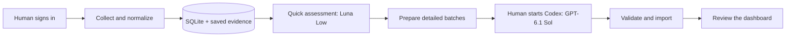

# Application Workflow

**Turning a repetitive job search into a structured workflow with Python, SQLite and staged AI assessment.**

I kept repeating the same work: collect vacancies from different sources, check whether they fit, read the promising ones in depth, and keep track of my conclusions. I built this project to automate those recurring steps and bring the results into one review dashboard.

**[Open the interactive dashboard demo ↗](https://marten-application-workflow-demo.saltychair1.chatgpt.site)**

The demo uses fictional vacancies and illustrative assessments. Search for a role, open its assessment details and save it to your shortlist. It preserves the working dashboard's visual style, filters, sortable columns, detail dialog and dark mode.

## From scattered vacancies to a focused shortlist



In my private working setup, I first complete any required sign-in or verification for the configured vacancy sources. The script then collects the available information, normalizes it, stores it, runs the compact first-pass assessment and prepares the promising vacancies for detailed review. Source access problems pause the affected collection work for human attention.

I start the prepared detailed-assessment task in Codex. The agent works through the assigned evidence, returns structured results and validates and imports them. I then use the dashboard to inspect the reasoning and decide which opportunities deserve my attention.

## Design decisions

| Decision | Why I made it |
| --- | --- |
| **Automate collection and normalization** | Repeating the same collection and cleanup steps manually adds work every day. A shared pipeline produces comparable vacancy records. |
| **Use SQLite as the system of record** | Sources, observations, clean versions and assessments stay linked. I can trace an assessment back to the evidence and profile used for it. |
| **Screen compact inputs first** | A first pass should identify plausible matches without spending detailed-review effort on every vacancy. Missing information remains uncertainty rather than an invented rejection reason. |
| **Match the model to the task** | The portfolio's quick-screening runner uses **GPT-6 Luna with Low reasoning**. Detailed review is human-started in **Codex with GPT-6.1 Sol** and receives fuller evidence. |
| **Prepare structured batches** | Each task has an explicit set of vacancies, a shared profile, fixed inputs and a defined output format. This controls context, supports consistent processing and keeps unfinished work inspectable. |
| **Validate before storing judgements** | Identity, input integrity, profile version, score consistency and evidence references are checked before results enter the dashboard. |
| **Keep the final decision human** | The dashboard presents fit, strengths, gaps and missing information together. Scores prioritize review; they are not probabilities or application decisions. |

The staged design is intended to reduce repeated work and concentrate model effort where it matters. I have not measured a percentage cost saving or a screening-accuracy improvement, so this repository makes no numerical performance claim.

## What the dashboard shows

- A sortable overview of assessed vacancies, fit and confidence.
- Search and filters for location, collection date and minimum fit.
- Detailed reasoning, strengths, gaps, missing information and assessment criteria.
- A personal shortlist, kept in the visitor's browser in the hosted demo.

The presentation ends at vacancy review. The hosted demo is a static preview generated from fresh fictional fixtures; it does not connect to my accounts, database or live vacancy sources.

## Implementation you can inspect

| Part | Code |
| --- | --- |
| Collection and evidence storage | [Collection service](src/job_system/application/collection.py), [artifact store](src/job_system/infrastructure/artifacts.py) |
| SQL persistence | [Repositories and transactions](src/job_system/infrastructure/database.py), [schema migrations](src/job_system/infrastructure/migrations/) |
| Clean vacancy records | [Normalization](src/job_system/application/cleaning.py), [data contracts](src/job_system/domain/clean_vacancies.py) |
| Two-stage assessment | [Assessment services](src/job_system/application/assessment.py), [Luna Low runner](src/job_system/infrastructure/screening_runner.py), [batch orchestration](src/job_system/application/portfolio.py) |
| Agent instructions | [Compact screening](prompts/vacancy-screening/v4/prompt.md), [detailed assessment](prompts/vacancy-assessment/v3/prompt.md) |
| Final review interface | [Dashboard service](src/job_system/application/dashboard.py), [frontend](src/job_system/web/static/) |

This is a focused portfolio edition of a privately used system. The collection/storage core, normalization, assessment validation and dashboard come from that project. Source-specific integrations and operational data are kept private; the included source adapter reads self-authored example HTML. The compact Codex runner and static export make the chosen workflow explicit in this edition.

Developed with substantial AI-assisted coding. My work focused on identifying the repeated tasks, defining the workflow and assessment criteria, choosing where to automate, and reviewing and refining the resulting implementation.

## Optional local exploration

Python 3.13; no runtime packages are needed for the fictional demo:

```sh
python run_demo.py demo
python run_demo.py dashboard serve
```

Open `http://127.0.0.1:8765/`. The demo never invokes a model. For real screening, prepared Codex tasks, tests and static export, see the [technical walkthrough](docs/walkthrough.md). See also [architecture](docs/architecture.md) and [validation](docs/validation.md).

No open-source license has been selected. Private source access and data are not distributed with this portfolio.
