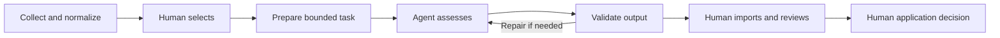

# Application Workflow

**A human-in-the-loop job application workflow built with Python, SQLite and structured AI-agent handoffs.**

The application preserves vacancy evidence and prepares bounded assessment tasks. A person chooses the work; an agent returns structured judgements; Python validates the results before import. The person reviews recommendations and decides what to do next.

This is a runnable portfolio edition of a private working project. It uses self-authored fictional vacancies, an invented profile and fictional mail. Production website adapters, accounts and operational history are excluded.

## Try it in two minutes

Requires **Python 3.13**. No runtime dependencies, credentials or model account are needed. From the repository root:

```sh
python run_demo.py demo
python run_demo.py dashboard serve
```

Open **http://127.0.0.1:8765/**. Stop the server with Ctrl+C. On some systems the Python command is `python3` or `py`.

The demo parses three HTML vacancies, stores and normalizes their evidence, prepares a sample selection, writes **explicitly simulated** agent results, validates and imports them, and demonstrates two mail classification proposals. No model is invoked. Re-running it preserves records and human decisions.

**To try the actual human/agent handoff in a separate dataset:**

```sh
python run_demo.py --workspace review collect
python run_demo.py --workspace review dashboard serve
```

Select an unassessed vacancy and click **Prepare selected**. Open the generated `HANDOFF.md` with your agent, let it write the assigned output, then validate and explicitly import it. Preparing never starts an agent. See the [review guide](docs/review-guide.md) for the complete sequence.

## What the project demonstrates

- **Evidence before inference:** raw artifact hashes, immutable clean versions and citations.
- **Human control:** explicit selection and work limits, separate recommendations and decisions.
- **Agentic work with a contract:** versioned prompts, bounded input packages and structured JSONL output; no agent product is required by the core.
- **Validation and persistence:** input identity, profile version, score bands and evidence references are checked before results are stored.
- **Recovery:** collection failures are recorded per source; prepared work survives interruption; invalid results can be repaired and revalidated.
- **Local review:** dashboard with vacancy evidence, agent handoffs, human decisions and fictional mail proposals.

A valid schema is not proof of a correct judgement. Scores are review aids, not calibrated probabilities.

## A complete review cycle



## Source integration

The bundled `LocalHTMLSource` parses a documented, fictional HTML format. It performs no network requests. Other sources can be added through `SourceAdapter` and a private adapter factory:

```sh
python run_demo.py collect --adapter my_private_adapter:create_source
```

A factory is trusted Python code and must be installed/importable locally. It maps its specific website or feed to the [neutral source contract](docs/source-adapters.md). Changing a domain alone does not make a scraper work on arbitrary websites. No universal scraper, live mailbox connector or automatic browser login is bundled.

## How this relates to the original project

The collection service, content-addressed artifact store, SQLite repositories and migrations, clean-data service, profile snapshots and assessment validation were transferred from the private working project. Provider-specific parsing and source priorities were removed; the normalizer now accepts neutral field names. The small CLI, local HTML adapter, dashboard and synthetic mail handoff were added for this review edition.

The original project has additional scheduled, screening, browser and mailbox workflows. This edition demonstrates the central collection → prepared assessment → validation → human review cycle without claiming full feature parity. See [architecture and provenance](docs/architecture.md).

This is a personal project developed with substantial AI-agent assistance. The technical presentation focuses on the workflow design, its working implementation and verifiable behaviour; it does not imply every line was written manually.

## Installation and tests

Direct checkout usage above needs no installation. For the optional `jobs` command:

```sh
python -m pip install -e .
jobs demo
jobs dashboard serve
```

For tests:

```sh
python -m pip install -e ".[dev]"
python -m pytest
```

Tests cover the transferred collection/storage core and the portfolio boundaries: exact task selection, tampered inputs, duplicate or misbound outputs, invalid citations, score consistency, import behaviour, mail evidence and the loopback API.

## Repository map

| Path | Purpose |
| --- | --- |
| `src/job_system/application/` | Collection, cleaning, prepared assessments and review orchestration |
| `src/job_system/domain/` | Evidence, clean vacancy facts and quality rules |
| `src/job_system/infrastructure/` | SQLite, migrations, artifact storage, locking and configuration |
| `src/job_system/adapters/sources/` | Neutral local HTML parser and existing fake source |
| `src/job_system/web/` | Loopback-only dashboard |
| `examples/` | Self-authored HTML, invented profile and fictional messages |
| `prompts/` | Agent-neutral handoff instructions and assessment schema |
| `tests/` | Original core tests and additional boundary tests |
| `docs/` | Review, architecture and source integration guides |

Runtime databases, outputs, logs and local preparation notes stay under ignored `var/` and `local/`. No original private history is carried over.

## Review status and scope

Prepared for **private GitHub review**. The repository has no live deployment and no automatic production synchronization. It does not send mail or submit applications. No open-source licence has been selected; private upload does not grant a redistribution licence. The [validation record](docs/validation.md) states what was actually checked.
