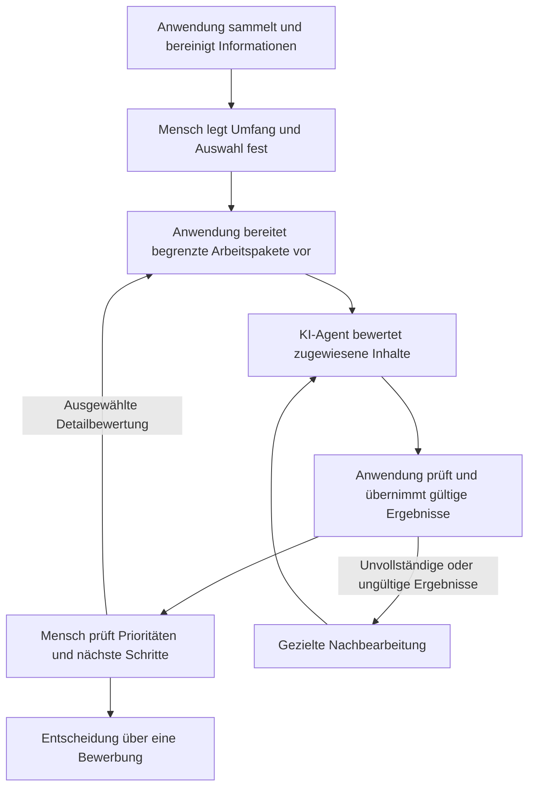

# Zusammenarbeit zwischen Mensch, KI-Agent und Anwendung

## Projektgedanke

Application Workflow ist ein Human-in-the-Loop-Workflow mit KI-Agenten. Er kombiniert regelbasierte Software, begrenzte agentische Bearbeitung und Entscheidungen des Menschen. Die Zusammenarbeit ist Teil der Architektur und soll in der Projektpräsentation sichtbar sein.

Der fachliche Ablauf wird unabhängig von einem bestimmten Agentenprodukt beschrieben. Das private Arbeitsprojekt verwendet derzeit eine konkrete Codex-Anbindung für bestimmte vorbereitete Aufgaben sowie einen interaktiven Agenten-Chat für die Detailbewertung. Diese Implementierung ist noch nicht als frei austauschbare Integration in die öffentliche Projektfassung übernommen.

## Rollen

| Rolle | Verantwortung |
| --- | --- |
| Mensch | Ziele und Präferenzen festlegen, Umfang und Auswahl bestimmen, priorisierte Ergebnisse beurteilen und über die tatsächliche Bewerbung entscheiden |
| Python-Anwendung | Daten sammeln und aufbereiten, Arbeitsaufträge vorbereiten, Ein- und Ausgaben zuordnen, Ergebnisse validieren und den persistenten Zustand verwalten |
| KI-Agent | Zugewiesene Inhalte interpretieren, Eignung und Lücken anhand der bereitgestellten Kriterien einordnen, Belege angeben und strukturierte Ergebnisse zurückgeben |

Validierte Ergebnisse können im festgelegten Ablauf automatisch importiert werden. Auch einzelne regelbasierte Statusübergänge sind im Arbeitsprojekt automatisiert. Human-in-the-Loop bedeutet hier konkrete Auswahl- und Entscheidungspunkte; es bedeutet keine zusätzliche manuelle Bestätigung jedes technischen Verarbeitungsschritts.

## Ablauf im vorhandenen Arbeitsprojekt

Die Darstellung fasst die Übergaben zusammen. Sie ist keine vollständige Abbildung aller CLI-Zustände oder Hintergrundschritte.

Im Arbeitsprojekt unterscheiden sich insbesondere zwei Pfade:

- Vorbereitete Kurzbewertungen und E-Mail-Aufträge können innerhalb eines festgelegten Umfangs über einen konkreten Agenten-Runner laufen.
- Die Detailbewertung wird in einem sichtbaren Agenten-Chat gestartet. Dieser verarbeitet die zuvor ausgewählten und vorbereiteten Arbeitspakete. Das Dashboard bereitet diese Aufgaben vor; es startet selbst keine KI-Bearbeitung.

Unterbrochene oder fehlerhafte Arbeit bleibt über gespeicherte Eingaben und begrenzte Nachbearbeitung nachvollziehbar. Eine reguläre Aufgabe endet mit ihrem vorgesehenen Arbeitspaket; eine größere Auswahl entsteht durch einen eigenen Auswahlschritt.

## Übergabevertrag statt Produktabhängigkeit

Für eine neutrale Darstellung sind die Ein- und Ausgaben entscheidend:

1. Die Anwendung erstellt ein begrenztes Paket mit Aufgabenkennung, ausgewählten Stelleninformationen, passender Profilversion, Arbeitsanweisung und Ergebnisschema.
2. Ein Agent erhält diesen Auftrag und die dafür benötigten Informationen. Die konkreten Dateien, Werkzeuge und zugelassenen Arbeitsschritte werden ausdrücklich beschrieben.
3. Der Agent liefert strukturierte Ergebnisse für die zugewiesenen Einträge zurück.
4. Die Anwendung prüft das Ergebnis anhand des jeweiligen Vertrags und übernimmt gültige Resultate.
5. Der Mensch beurteilt Empfehlungen und trifft die vorgesehenen Auswahl- und Bewerbungsentscheidungen.

Das Arbeitsprojekt nutzt dafür bereits vorbereitete Dateien, versionierte Anweisungen, strukturierte Ausgaben und CLI-Befehle zur Validierung und Übernahme. Diese Mechanismen können fachlich agentenneutral erklärt werden.

Ein anderes Agentensystem muss diesen Übergabevertrag erfüllen. Seine Unterstützung ist erst dann eine umgesetzte Funktion, wenn Ausführung, Werkzeugzugriff, Ergebnisformat und Rückführung geprüft sind. Ein frei wählbarer Runner für mehrere Agentenprodukte ist derzeit nicht Teil der öffentlichen Projektfassung.

## Grenzen der KI-Bearbeitung

Eine Schema- oder Konsistenzprüfung allein beweist keine inhaltlich richtige Bewertung. Quellenbezug, fehlende Informationen und Unsicherheit bleiben deshalb sichtbar. Stellenanzeigen und E-Mail-Inhalte sind zu verarbeitende Daten; sie erteilen dem Agenten keine neuen Arbeitsaufträge.

Die Entscheidung über eine Bewerbung bleibt beim Menschen. Der dargestellte Bewertungsablauf versendet keine Bewerbung. Zugangsdaten, private Profile und produktive Browserzustände sind keine Bestandteile der öffentlichen Demo.

## Geplante öffentliche Demonstration

Die neutrale Demo soll dieselben Übergaben mit vollständig erfundenen Daten zeigen:

- Einen kleinen Bestand an Stellenanzeigen und ein fiktives Profil bereitstellen.
- Eine Auswahl von Hand festlegen und ein begrenztes Arbeitspaket erzeugen.
- Beispielhafte strukturierte Agentenergebnisse einlesen, validieren und im Dashboard darstellen.
- Die interaktive Bearbeitung eines solchen Pakets zusätzlich erklären; konkrete Live-Agentenanbindungen separat kennzeichnen.

Ein Durchlauf mit vorgegebenen Beispieldaten muss auch ohne Agentenkonto möglich sein. Eine simulierte Ergebniseingabe wird dabei ausdrücklich als Simulation bezeichnet.

## Aktueller Stand dieser Projektfassung

Dieses Dokument beschreibt das Konzept und die im privaten Arbeitsprojekt gefundenen Übergaben. Im neuen Repository sind bisher Datenmodelle, gemeinsame Schnittstellen und die Fake-Quelle vorhanden. Die Arbeitspakete, Ergebnisvalidierung, KI-Ausführung und das Dashboard werden erst noch schrittweise übernommen.
